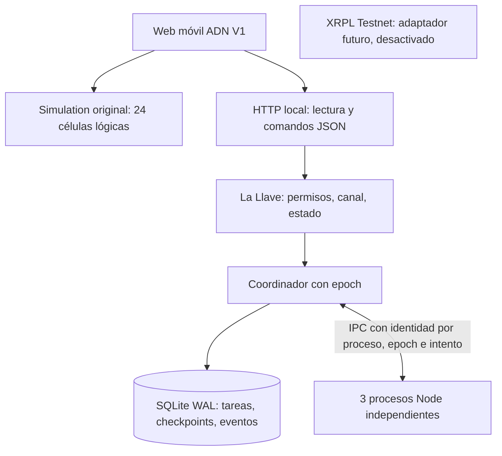

# PHERSAA ADN V1 — auditoría y primera entrega

Auditoría del 9 de noviembre de 2026. No se modifican archivos históricos ni los otros tres repositorios. Alcance: inspección de fuentes, pruebas, manifiestos y archivos de despliegue; no es una auditoría de seguridad exhaustiva ni certifica resultados históricos.

## Fuentes fijadas

| Repositorio | Commit auditado | Hallazgos y reutilización |
|---|---|---|
| PherSAA/phenom-adn-simulacion | `5523f0fdbd85d2f0123c1be3addd55a339d54bfd` | `engine.js`: 24 células, ocho grupos, permisos y canales, cola por prioridad, checkpoint simulado, recuperación y resultado 338350. `tests/engine.test.cjs` conserva invariantes. Se reutiliza directamente en la nueva UI y para derivar identidades del backend, sin copiar ni cambiar el motor. `teletransporte/model.cjs` queda histórico. |
| PherSAA/split-run | `5b4edd8396a6ec6e2e0f168a741ffac7f0107c47` | Colección de páginas y prototipos. `app-2telefonos/app.js`: señalización manual WebRTC, huellas y piezas. `app-llave-real/app.js`: llavero, revocación, nonce y BroadcastChannel local. `app-quorum/`: tres Web Workers, firmas P-256 y verificador de actas. Se reutiliza el criterio de verificar resultados y distinguir navegador/dispositivo/proceso. No se importan pagos ni demos completas. |
| PherSAA/phenom-xrpl-agentes | `850bdbc13a586d322ad209518d986ae4ed3f5981` | `api/src/llave.js`: registro de workers, firma de resultados, canal y replay. `api/src/tasks.js` y pruebas de validación; `split.js` significa reparto monetario, no reparto de cómputo. `iaconteol-fix/engine.py`: procesos spawn, SQLite WAL, transacciones, supervisor, reencolado. Se adapta ese patrón al laboratorio Node/SQLite y se añaden epoch y número de intento. No se copia su motor entero: importa `crypto_analysis`, ausente en este checkout. |
| PherSAA/phenom-campo | `6e5a09f456cf1e82dcc43fb6f52c8a132df32006` | `celula-worker.js`: trabajo SHA-256 real en Web Worker, ingesta de cola sintética. `firma.js`: firma de intenciones offline e IndexedDB; `campo.js`: exportación y medición manual de batería iPhone. Se reutilizan las limitaciones explícitas de Safari, exportación y suspensión; no se atribuye a estos workers independencia de máquina. |

Los cuatro commits no contienen workflows en `.github/workflows`. ADN tiene dos archivos de pruebas; la API tiene seis. Split Run incluye un verificador de actas, sin fixture de acta ni suite automatizada encontrada. Campo no incluye una suite automatizada. La API contiene Dockerfile, Fly y Netlify: son configuración de despliegue, no evidencia de servicios activos.

## Riesgos encontrados antes de integrar

- `iaconteol-fix/engine.py` reencola al arrancar cualquier coordinador, sin fencing compartido: dos coordinadores pueden interferir. La condición worker/status por sí sola no identifica una asignación antigua.
- El contador histórico de duplicados por clave primaria mide registros duplicados, no ejecuciones repetidas. El nuevo reporte conserva esa distinción.
- `LlaveRegistry` borra el conjunto de nonces al superar su límite: no es un almacén persistente de replay. No se adopta como autorización de producción.
- La API acepta Mainnet por configuración y su README incluye instrucciones Mainnet. No se levanta esa API ni se incorpora al módulo V1; los tests ejecutados son locales con mocks. El módulo nuevo no importa SDKs XRPL, semillas, wallets ni endpoints financieros.
- La geometría no autentica nodos. La autorización del laboratorio depende de política de permisos/canal y del IPC creado por el coordinador; el administrador de la máquina sigue siendo de confianza.

## Arquitectura integrada

**Implementado en esta etapa:** dos modos explícitos de UI; identidad y grupo derivados del motor original; tareas con ID idempotente y conflicto por contenido; transacciones serializadas; checkpoint de índice y suma parcial verificada matemáticamente; reinicio del coordinador con recuperación; timeout de progreso; fallo inducido matando un proceso; reasignación; rechazo de mensajes de intento anterior y coordinadores antiguos; auditoría persistente; exportación JSON; workflow de pruebas, benchmark y artefacto móvil. La tarea real calcula una suma de cuadrados; se distribuyen tareas completas entre procesos, no fragmentos de una sola tarea. Solo el modo simulado divide una tarea en partes.

**Siguiente etapa propuesta:** contrato de tareas versionado y adaptadores de capacidades; extracción con pruebas del registro firmado de la API, replay durable y política exclusivamente Testnet; transporte autenticado entre hosts; autoridad de fencing compartida; pruebas de partición y recuperación en máquinas distintas. El transporte entre teléfonos de Split Run requiere validación propia antes de usarlo como backend. Se deben añadir pruebas a cada adaptador cuando se incorpore.

## Evidencia de ejecución

Entorno Linux, Node 24.22.1, Python 3.12.14. Comandos y resultados de esta entrega:

- `node --test tests/*.cjs`: 28/28 pasan (22 históricas + seis nuevas). Las nuevas cubren permisos/canales/identidad, idempotencia, checkpoint, rechazo de resultados falsos y antiguos, reinicio persistente y fencing, procesos con PID distintos, SIGKILL, SIGSTOP con detección por timeout, stop/start, HTTP y bloqueo de origen ajeno.
- `node adn-v1/benchmark.cjs results.json`: prueba de 30 tareas en tres workers configurados; inyecta un fallo después de observar un checkpoint, comprueba todas las sumas y exporta eventos, intentos y métricas. Los números observados se documentan en `ADN-V1-RESULTS.md`; no constituyen un SLA.
- API histórica: `npm ci --ignore-scripts --cache /workspace/work/npm-cache` completa. `npm test` falla porque `node --test test/` no resuelve ese directorio en Node 24. Se ejecutó `node --test test/*.test.js`: ver resultado en `ADN-V1-RESULTS.md`. No se cambian sus pruebas para ocultar fallos.
- Benchmark Python histórico: bloqueado por `ModuleNotFoundError: crypto_analysis`. No se presenta como probado ni se inventa el módulo faltante.
- Campo: comprobación sintáctica con `node --check` de `campo.js`, `pagos.js`, `celula-worker.js` y `firma.js`. No es prueba funcional en teléfonos.
- Split Run: el verificador `app-quorum/docs/verify-acta.mjs` necesita un acta externa; no hay fixture incluido. Invocarlo sin argumento falla. La inspección/sintaxis no demuestra quórum entre teléfonos.

La interfaz usa viewport móvil, controles de 46 px, cuadrícula adaptable y estados accesibles. **No validada en un iPhone físico ni en navegador automatizado en esta sesión**: el entorno Sites gestionado indica `SITES_MANAGED_LINUX_CONTAINER=1`, no hay `cua_repl.js` ni herramienta NodeREPL disponible; su guía de preview exige omitir esa QA sin improvisar otro controlador. Se verifican HTTP y JavaScript, sin atribuirles validación visual.

## Límites operativos

Un host, un archivo SQLite y un coordinador activo. No hay HA, consenso, independencia de organizaciones, resistencia a administrador malicioso ni transporte de red entre hosts. Solo C1–C3 tienen workers configurados por defecto; las 24 identidades existen y la UI muestra cuáles tienen PID. Las demás no se presentan como procesos activos. Capacidad real: una tarea por proceso, canal de trabajo 1; cambiar permisos/canal puede detener su ejecución y reencolarla. Un checkpoint permite repetir trabajo después del último guardado: no se promete ejecución exactamente una vez, solo un registro terminal por tarea.

El registro sirve para inspección, no está firmado ni protegido contra edición local. Los datos permanecen entre start/stop y reinicios: las métricas son acumuladas por archivo, no una nueva cohorte por botón. Throughput: completadas / tiempo desde primera tarea; latencia: creación a finalización, incluida espera y parada. Pérdidas: tareas con estado no contabilizado; pendientes/en curso se muestran en el JSON, no son pérdidas. Duplicados: registros terminales repetidos, no intentos. No se miden pérdida/latencia de paquetes ni batería.

Límite de 10.000 tareas persistidas, sin archivado/rotación automática. La UI muestra eventos recientes y exporta el registro completo. No está optimizado para un historial grande. `node:sqlite` requiere Node 24; no hay dependencia npm nueva. El laboratorio escucha solo en 127.0.0.1, con bloqueo de Origin/Host para mutaciones y sin CORS. No tiene autenticación multiusuario: no exponerlo con un proxy público. El workflow no despliega ni abre puertos. No se hace ninguna operación Mainnet ni Testnet.
